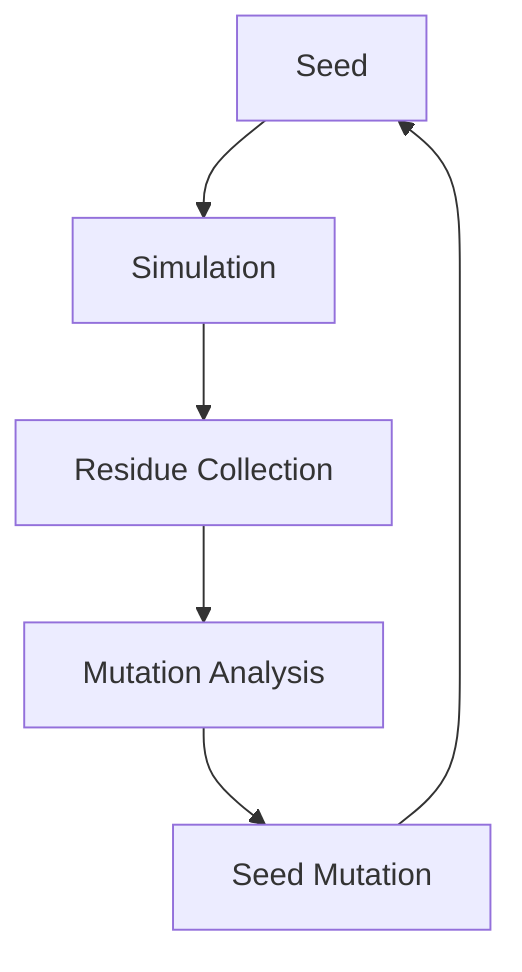

# Molting Engine Architecture

This document describes the functional components of the Molting Engine used for evolutionary agent optimization.

## Component Responsibilities

### 1. ResidueCollector
- **Input**: Raw telemetry and exception traces from simulation runs.
- **Processing**: Aggregates observations into discrete temporal entries.
- **Output**: A "residue" (historical log of agent performance/failure).

### 2. SeedMutationService
- **Input**: Current agent configuration (Seed) and the accumulated Residue.
- **Processing**:
    - **Learning Phase**: Analyzes error frequencies in the residue. If error counts exceed a threshold, it applies deterministic parameter adjustments (e.g., increasing `robustness`).
    - **Drift Phase**: Applies stochastic mutations to seed values to ensure the search space is explored.
- **Output**: A mutated Seed for the next generation.

### 3. MoltLifecycle
- **Input**: Initial seed, mutation service, and collector.
- **Processing**: Orchestrates the loop: `Load -> Execute -> Collect -> Mutate -> Save`.
- **Output**: An incremented generation count and a updated configuration file.

## Evolutionary Logic Flow

